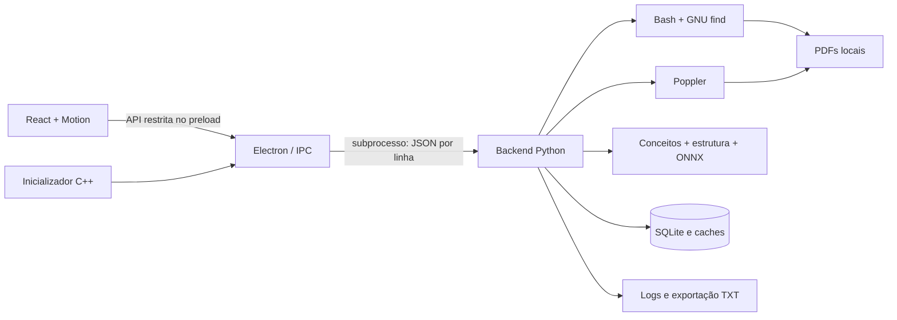

<div align="center">


# Atlas PDF

**Sua biblioteca de PDFs, organizada pelo conteúdo.**

Aplicativo local para Linux que encontra documentos, extrai texto e estrutura,
identifica assuntos e reúne o acervo em uma interface de biblioteca.

**React · Electron · Python · SQLite · Poppler · Inferência ONNX em CPU**

</div>

## Visão geral

O Atlas PDF foi criado para explorar bibliotecas de estudo espalhadas por pastas.
Em vez de depender apenas do nome do arquivo, combina texto, título, sumário,
cabeçalhos e conceitos para sugerir uma organização. O foco inicial é matemática,
com categorias abertas para documentos de outros assuntos.

A versão do projeto é **3.3.0**, registrada em [`package.json`](package.json).
Os PDFs permanecem em seus locais originais: o Atlas não os move, renomeia ou
modifica. A leitura do arquivo completo é feita pelo leitor de PDFs do sistema.

O processamento do acervo acontece no computador, sem conta, chave de API ou
serviço de inferência remoto. A preparação do ambiente requer internet para
instalar dependências e obter o modelo; depois disso, a indexação é local.

## Funcionalidades

| Área | Recursos |
| --- | --- |
| Biblioteca | Capas extraídas dos PDFs, grade e lista, ordenação e paginação |
| Pesquisa | Título, autor, caminho, palavras e temas extraídos; atalho `Ctrl K` |
| Navegação | Áreas da matemática, famílias, temas descobertos e documentos para revisão |
| Organização pessoal | Favoritos, recentes e temas claro/escuro persistentes |
| Detalhes | Metadados, tipo de documento, evidências, conceitos e ajuste manual de categoria |
| Descoberta | Pastas escolhidas, diretórios pessoais e locais acessíveis do computador |
| Indexação | Progresso, cancelamento, cache, detecção de duplicatas e arquivos ausentes |
| Exportação | Catálogo em TXT, logs e relatórios de reclassificação |
| Acessibilidade | Preferência de movimento reduzido respeitada nas animações |

## Instalação e execução pelo código-fonte

### Ambiente

O ambiente de referência do projeto é **Linux x86_64, Ubuntu 24.04 e Python 3.12**.
Windows, macOS e outras combinações de distribuição e arquitetura não são alvos
validados. O empacotamento depende de ferramentas e caminhos de sistema Linux.

Você precisa de:

- Node.js e npm compatíveis com as dependências fixadas em `package-lock.json`;
- Python 3.12 disponível em `/usr/bin/python3`;
- `uv` no `PATH`, usado para instalar as dependências de inferência isoladamente;
- compilador C++17, como `g++`;
- Bash, GNU find, Poppler (`pdfinfo`, `pdftotext`, `pdftoppm` e `pdftohtml`);
- sessão gráfica e bibliotecas necessárias ao Electron;
- `tar`, `gzip`, `ldd` e fontes DejaVu para o empacotamento.

Em Ubuntu 24.04, parte dessas dependências pode ser instalada com:

```bash
sudo apt install build-essential python3 poppler-utils findutils fonts-dejavu-core
```

Node.js, npm e `uv` devem estar instalados separadamente. Não é necessário
instalar PyTorch, configurar uma GPU ou fornecer credenciais de IA.

### Preparar e abrir

```bash
git clone https://github.com/luizfelipejs/atlas-pdf.git
cd atlas-pdf
npm ci --no-audit --no-fund
bash build.sh
./run.sh --data-dir ./data
```

`build.sh` prepara o modelo e suas dependências, compila a interface com Vite e
compila o inicializador C++. A preparação pode baixar arquivos grandes; reserve
espaço para o modelo, o runtime Electron, as dependências e os artefatos de build.

O script [`tools/prepare_semantic.py`](tools/prepare_semantic.py):

1. baixa o modelo ONNX quantizado e o tokenizer de uma revisão fixa;
2. valida os dois arquivos por SHA-256;
3. instala NumPy, ONNX Runtime e Tokenizers em `build/semantic-python`;
4. registra a identificação e os hashes do modelo em um manifesto.

Os pesos e o tokenizer **não são versionados neste repositório**. Para preparar
ou conferir esses assets separadamente:

```bash
/usr/bin/python3 tools/prepare_semantic.py
/usr/bin/python3 tools/prepare_semantic.py --check
```

O segundo comando verifica os hashes dos assets; não é uma validação completa
do ambiente de inferência.

### Primeiro uso

1. Abra o aplicativo com `./run.sh --data-dir ./data`.
2. Use **Buscar PDFs** ou selecione uma pasta pelo menu ao lado.
3. Acompanhe o progresso da extração e classificação.
4. Explore as áreas e os temas descobertos; confira os documentos em **Revisar**.
5. Abra os detalhes para entender a classificação e corrigir a categoria.

As categorias alteradas manualmente são preservadas nas buscas e reclassificações.
O repositório não inclui uma biblioteca pronta: seu catálogo é criado localmente.

### Desenvolvimento da interface

```bash
npm run dev
```

O Vite permite trabalhar na interface no navegador. As operações de arquivos,
indexação e integração com o sistema dependem da ponte Electron e precisam do
aplicativo desktop. Para recompilar a interface e abrir o desktop:

```bash
npm run build
./run.sh --data-dir ./data
```

### Sandbox do Electron

O aplicativo utiliza sandbox e isolamento de contexto. Em sistemas que restringem
namespaces de usuário, o inicializador procura um helper SUID compatível do
Chrome/Chromium, verificando proprietário e permissões. Não altera AppArmor ou
`sysctl` nem desativa o sandbox automaticamente.

`run.sh` copia o runtime para uma pasta temporária privada, evitando o problema
do helper Chromium com espaços no caminho. Se a abertura falhar por sandbox,
confira a configuração do Chromium/Electron na distribuição e a disponibilidade
de um helper compatível.

## Como a indexação funciona

### Descoberta e preservação dos originais

A busca padrão reconhece diretórios pessoais XDG, incluindo Downloads, Documentos
e Área de trabalho. Há opções para uma pasta específica, toda a pasta pessoal
ou locais acessíveis em `/home`, `/media`, `/mnt`, `/run/media`, `/opt` e `/srv`.

A descoberta ignora links simbólicos, caches, repositórios Git, `node_modules`,
ambientes de desenvolvimento e diretórios voláteis. Falhas de leitura são
registradas e não exigem privilégios administrativos para continuar.

SHA-256 identifica conteúdo duplicado, preservando o registro dos caminhos das
cópias. Tamanho, data e versões dos algoritmos permitem reutilizar resultados.
Uma varredura parcial só atualiza ausências nas raízes percorridas com sucesso.
Cancelamentos preservam o trabalho concluído; uma trava impede indexações
simultâneas no mesmo catálogo.

### Extração de texto e estrutura

O Poppler extrai metadados, texto, capas e informações de estrutura. O Atlas
procura títulos, cabeçalhos, sumários, marcadores, idioma e sinais do tipo de
documento, como livro, artigo, slides ou lista de exercícios.

Livros longos são analisados por amostragem: até 60 páginas distribuídas,
incluindo as primeiras 18 e amostras em outras regiões. Há limites de tempo e
volume de texto. Portanto, a classificação **não representa uma leitura integral
garantida**. PDFs digitalizados sem texto selecionável precisam de OCR externo;
o Atlas não inclui um motor de OCR.

### Classificação e categorias abertas

A organização combina três componentes:

- **Assuntos matemáticos:** taxonomia própria com 25 alas específicas em sete
  famílias, além de Outros assuntos e Revisar. Conceitos multilíngues, frequência,
  diversidade e evidências distribuídas ajudam a distinguir um assunto das
  ferramentas matemáticas apenas utilizadas pelo documento.
- **Representação semântica local:** o modelo
  `sentence-transformers/paraphrase-multilingual-MiniLM-L12-v2`, executado em CPU
  com ONNX Runtime, produz vetores de 384 dimensões. O texto usa blocos de 80
  palavras e até 96 janelas distribuídas, com tratamento do limite de tokens.
- **Categorias abertas:** combinam corpo do texto, estrutura e expressões-chave,
  com centralização dos vetores, limiares adaptativos e consolidação dos grupos.
  Documentos fora das alas existentes podem formar novos temas.

O código atual de categorias está em [`backend/categories.py`](backend/categories.py).
O módulo [`backend/semantic_catalog.py`](backend/semantic_catalog.py) também
preserva lógica de centroides utilizada pelo projeto; o antigo limiar global
não deve ser interpretado como regra única do motor atual.

Os nomes sugeridos são extraídos do conteúdo, com métodos lexicais e semânticos;
não são frases inventadas por um LLM. O painel apresenta expressões e trechos que
sustentam os temas. IDs de categorias e escolhas manuais são preservados durante
as operações previstas pelo motor.

As pontuações são **heurísticas, não probabilidades calibradas**. Ainda não há
um benchmark rotulado por pessoas que demonstre precisão geral. Nomes genéricos,
assuntos próximos e textos insuficientes podem exigir revisão manual. Se a
inferência não estiver disponível, o sistema mantém a classificação por conceitos
e informa a limitação.

### Reclassificação

**Reclassificar PDFs** reavalia documentos já catalogados, cria um backup
consistente do SQLite e registra as mudanças. Não altera os PDFs originais.
O processo reutiliza caches válidos e preserva ajustes manuais.

## Arquitetura



A interface é servida pelo protocolo local `atlas://app`, com CSP, sandbox,
`contextIsolation` e Node desativado no renderer. O preload expõe operações
específicas; o processo principal valida a origem das mensagens IPC. As capas
são disponibilizadas a partir do catálogo e da pasta de miniaturas.

| Diretório/arquivo | Responsabilidade |
| --- | --- |
| `frontend/` | Componentes React, estilos, fontes e navegação por assuntos |
| `desktop/` | Processo principal Electron e ponte preload |
| `backend/indexer.py` | CLI, catálogo, indexação e reclassificação |
| `backend/classifier.py`, `backend/taxonomy.py` | Conceitos e taxonomia de assuntos |
| `backend/structure.py` | Extração e interpretação da estrutura dos PDFs |
| `backend/semantic.py` | Encoder ONNX e representação vetorial |
| `backend/topics.py`, `backend/categories.py` | Expressões-chave e categorias abertas |
| `scripts/discover_pdfs.sh` | Descoberta dos arquivos |
| `tools/` | Preparação, inicialização, empacotamento e verificação |
| `tests/` | Testes Python e testes desktop com Playwright |
| `assets/` | Ícones, metadados e licença do modelo |
| `ui/` | Implementação Qt anterior; não é a interface do build atual |

## Armazenamento e privacidade

Com `--data-dir ./data`, o catálogo fica na pasta `data` do projeto. Sem a opção,
o padrão é `$XDG_DATA_HOME/atlas-pdf` ou `~/.local/share/atlas-pdf`.
`ATLAS_DATA_DIR` também permite configurar o diretório no desktop.

```text
data/
├── catalog.sqlite3             catálogo, associações e dados semânticos
├── paths.txt                   caminhos encontrados
├── thumbnails/                 capas por conteúdo
├── text-cache/                 amostras de texto comprimidas
├── structure-cache/            estrutura extraída
├── backups/                    snapshots antes de reclassificações
├── logs/                       eventos e falhas de leitura
├── reclassification-latest.json
└── scan.lock
```

Favoritos, recentes e preferências ficam no perfil Electron, normalmente em
`$XDG_CONFIG_HOME/Atlas PDF` ou `~/.config/Atlas PDF`, separados do catálogo.
Para preservar toda a experiência de uso, mantenha backups do catálogo, do perfil
e dos próprios PDFs: o catálogo não substitui uma cópia dos documentos.

Logs, caches, exportações e relatórios podem conter caminhos, títulos e trechos
do acervo. O `.gitignore` exclui dados locais, PDFs, bancos, logs, configurações
privadas, relatórios do acervo e arquivos gerados. Nada disso acompanha o código.

## Linha de comando

É possível utilizar o backend sem abrir a interface:

```bash
./run.sh --backend --data-dir ./data defaults
./run.sh --backend --data-dir ./data scan --root "$HOME/Downloads"
./run.sh --backend --data-dir ./data list
./run.sh --backend --data-dir ./data categories
./run.sh --backend --data-dir ./data export --output ./data/catalogo.txt
```

Outras operações disponíveis:

```bash
# Busca nos diretórios pessoais padrão
./run.sh --backend --data-dir ./data scan

# Amplia a busca: escolha o escopo que pretende catalogar
./run.sh --backend --data-dir ./data scan --all-home
./run.sh --backend --data-dir ./data scan --computer

# Reavalia o catálogo ou documentos identificados pelo comando list
./run.sh --backend --data-dir ./data reclassify
./run.sh --backend --data-dir ./data reclassify --id ID --force

# Ajusta uma categoria manualmente
./run.sh --backend --data-dir ./data set-category --id ID --category 'Topologia'
```

Substitua `ID` pelo identificador real do documento. `--root` pode ser repetido.
O backend emite eventos JSON por linha. No executável empacotado, substitua
`./run.sh` por `./dist/AtlasPDF`, mantendo `--backend` e os demais argumentos.

## Testes e verificações

Após preparar o ambiente:

```bash
# Testes do backend
/usr/bin/python3 -m unittest discover -s tests -q

# Build da interface
npm run build

# Integração desktop (requer sessão gráfica e sandbox funcional)
npm run test:desktop
```

Os testes cobrem classificação, categorias, estrutura, temas, embeddings, caches,
duplicatas, persistência, alterações manuais, cancelamento e indexação. Os testes
desktop usam PDFs sintéticos e verificam a ponte Electron, pesquisa, capas,
favoritos, detalhes, exportação e outros fluxos. Confira eventuais testes pulados
quando o modelo ou dependências estiverem indisponíveis.

A presença dessas suítes não implica cobertura completa nem validação em todas
as distribuições Linux.

## Empacotamento

```bash
bash build.sh --package
/usr/bin/python3 tools/verify_package.py
./dist/AtlasPDF --data-dir ./data
```

O resultado é um executável ELF que reúne interface, Electron/Chromium/Node,
Python, dependências de inferência, modelo, Bash, GNU find, Poppler e bibliotecas
selecionadas. O inicializador extrai o conteúdo para uma pasta temporária privada.

A glibc, o carregador ELF, os drivers, a sessão gráfica e o suporte ao sandbox
continuam dependendo do sistema. **Um executável único não significa
compatibilidade universal.** O build de referência utiliza Ubuntu 24.04.

`verify_package.py` exercita o pacote com um `PATH` reduzido a `tar` e `gzip`,
verificando o uso dos componentes embarcados. Binários de `dist/` não são
versionados; este repositório distribui o código e as instruções de build.

## Limitações conhecidas

- Sem OCR integrado para PDFs compostos exclusivamente por imagens.
- Classificação baseada em amostragem e heurísticas, sujeita a revisão.
- Sem sincronização de biblioteca entre dispositivos.
- Leitura completa no visualizador de PDFs padrão do sistema.
- Inferência e extração podem ser demoradas em acervos grandes; caches reduzem
  trabalho posterior, mas a primeira indexação exige mais processamento.
- Empacotamento e inicialização dependem do ambiente Linux descrito acima.

## Nota ética e transparência sobre o uso de IA

O Atlas PDF foi desenvolvido com assistência de inteligência artificial, incluindo
apoio à escrita e revisão de código e documentação. Essa participação é declarada
para que o projeto não seja apresentado como uma implementação inteiramente
escrita à mão. A proporção exata de conteúdo produzido com assistência não foi
mensurada.

O uso de IA não transfere a responsabilidade pelo projeto: decisões de escopo,
revisão, testes e publicação continuam sob responsabilidade de quem o desenvolve
e mantém. Código gerado pode conter erros, dependências inadequadas ou suposições
incorretas; assistência automatizada não substitui validação humana. A existência
de testes também não constitui garantia de ausência de falhas.

Há uma distinção entre **IA utilizada no desenvolvimento** e **IA utilizada pelo
aplicativo**. Durante o uso, o Atlas executa um modelo de embeddings localmente
para auxiliar a organização dos PDFs. Não envia o acervo a um LLM remoto. Isso
não deve ser interpretado como uma declaração sobre quais ferramentas foram
utilizadas durante todo o histórico de desenvolvimento.

As classificações são sugestões, sujeitas aos limites e vieses do modelo e das
heurísticas. Elas podem funcionar de forma desigual entre idiomas, áreas e tipos
de documento. O usuário pode inspecionar evidências e corrigir categorias; as
pontuações não devem ser tratadas como certeza ou avaliação da qualidade de uma
obra.

O projeto reconhece a contribuição dos autores dos modelos, bibliotecas e demais
componentes de terceiros. Usar IA não elimina obrigações de atribuição, licença
ou respeito à privacidade. Ao contribuir, declare assistência relevante de IA,
revise os resultados e evite incluir documentos pessoais ou conteúdo confidencial
em prompts, exemplos, logs e materiais publicados.

## Contribuições e componentes de terceiros

Ao relatar um problema, inclua distribuição, versão do Python/Node, comando
executado e passos para reprodução. Prefira PDFs sintéticos e remova informações
pessoais de logs e caminhos antes de anexá-los.

Consulte [`THIRD_PARTY.md`](THIRD_PARTY.md) para os componentes e seus avisos de
licença. O modelo inclui sua própria licença em `assets/models/minilm/LICENSE`.
Este repositório ainda não define uma licença própria para o código do Atlas;
as licenças das dependências não substituem essa decisão.
